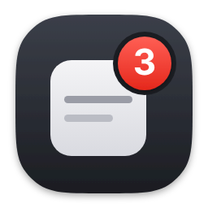
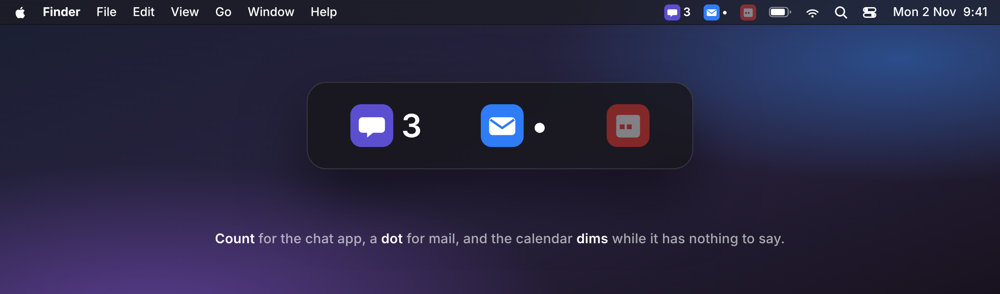
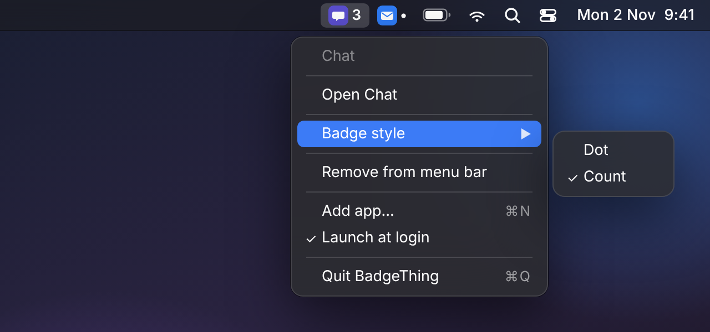
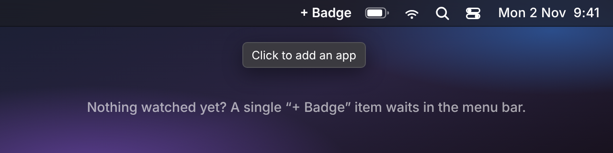
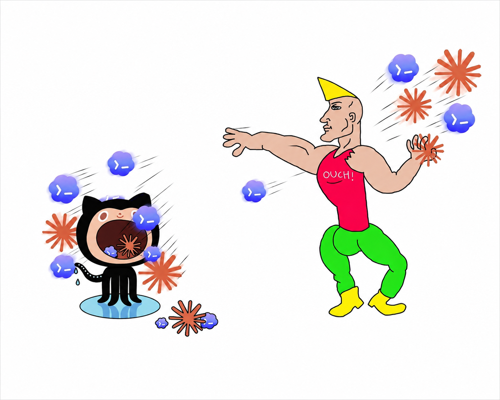

<div align="center">



# BadgeThing

### Dock badges, in your menu bar.

Pick an app. Its unread badge shows up next to the clock, so you can hide the Dock and still know when something needs you.

[](https://github.com/sgstq/badgething/releases/latest/download/BadgeThing.dmg)

<sub>Apple Silicon · macOS 13+</sub>

<br />



</div>

<br />

## The Dock is where badges live. Until now.

Badges only show in the Dock, and the Dock is the first thing most people hide. BadgeThing reads the badge straight off the Dock tile and mirrors it as a menu-bar item, one per app you choose. A count, or just a dot. Click it and the app comes to the front.

No window. No Dock icon of its own. It just sits in the menu bar.

<table>
<tr>
<td width="33%" valign="top">

**Any app**<br />
Slack, Mail, Messages, Discord, Telegram, Calendar. If it puts a badge on its Dock icon, BadgeThing can show it.

</td>
<td width="33%" valign="top">

**Count or dot**<br />
Show the number, or just a dot when there is something new. Pick per app from the right-click menu.

</td>
<td width="33%" valign="top">

**Quiet when quiet**<br />
When an app has no badge, its item dims instead of disappearing, so the menu bar never jumps around.

</td>
</tr>
</table>

## How it works

1. **Add.** Click **+ Badge** in the menu bar and pick an app from Applications.
2. **Watch.** BadgeThing polls the Dock a few times a second and mirrors whatever badge the app shows.
3. **Click.** Left-click opens the app, like clicking its Dock icon. Right-click for the menu.

That's the whole app.

## Made for the menu bar

<table>
<tr>
<td width="58%" valign="top">

</td>
<td width="42%" valign="top">

</td>
</tr>
<tr>
<td align="center"><sub>Right-click any item for its menu</sub></td>
<td align="center"><sub>Before you add anything, a single + Badge item waits</sub></td>
</tr>
</table>

## Everything else you'd want

- **One item per app.** Watch as many apps as you like. Each gets its own icon in the menu bar.
- **Opens like the Dock.** A click brings the app forward and reopens its window if you had closed it.
- **Launch at login.** One toggle in the menu, using the system login-items API.
- **Remembers your list.** Watched apps and their badge style survive restarts.
- **Light on your Mac.** A few kilobytes of Swift, no window, no network, almost no CPU.

## Privacy

BadgeThing never touches the network. It reads badge text from the Dock through macOS Accessibility, which is why it asks for that permission on first launch, and it reads nothing else. Your list of apps is stored in the app's own preferences on your Mac.

## Install

**[Download the latest DMG](https://github.com/sgstq/badgething/releases/latest/download/BadgeThing.dmg)**, open it and drag **BadgeThing** into Applications. On first launch, allow Accessibility access when macOS asks (System Settings → Privacy & Security → Accessibility), then click **+ Badge** and pick an app.

If macOS says it can't verify the developer, open System Settings → Privacy & Security, scroll down and click **Open Anyway**.

An app has to be running, or kept in the Dock, for it to have a badge at all. Requires macOS 13 or later.

<details>
<summary>Build from source</summary>

<br />

Requires macOS 13+ and the Swift toolchain (Xcode or Command Line Tools).

```bash
./release.sh          # builds BadgeThing.app and BadgeThing.dmg
open BadgeThing.app
```

For a notarized build, set up a notarytool profile once and export your Developer ID before running the script:

```bash
xcrun notarytool store-credentials "badgething" \
    --apple-id "you@example.com" \
    --team-id "YOUR_TEAM_ID" \
    --password "app-specific-password"

export DEVELOPER_ID_APP="Developer ID Application: Your Name (TEAMID)"
export NOTARY_PROFILE="badgething"
./release.sh
```

</details>

<details>
<summary>Releasing</summary>

<br />

Releases are cut automatically when a PR is merged to `main`. The version is bumped according to the PR's labels:

| Label         | Result                |
|---------------|-----------------------|
| _(none)_      | Patch bump (default)  |
| `bump:minor`  | Minor bump            |
| `bump:major`  | Major bump            |
| `bump:skip`   | No release            |

The workflow computes the next version from the latest `v*` tag, builds the DMG, and uploads it to a GitHub Release with generated notes. You can also push a tag (`git tag v0.4.0 && git push --tags`) or run the Release workflow by hand.

To sign and notarize in CI, add these repository secrets. The workflow picks them up automatically:

| Secret                                | Value                                                    |
|---------------------------------------|----------------------------------------------------------|
| `DEVELOPER_ID_APP_CERT_P12_BASE64`    | `base64 -i cert.p12` of the .p12 exported from Keychain  |
| `DEVELOPER_ID_APP_CERT_PASSWORD`      | Password used when exporting that .p12                   |
| `DEVELOPER_ID_APP_IDENTITY`           | `Developer ID Application: Your Name (TEAMID)`           |
| `APPLE_ID`                            | Your Apple ID email                                      |
| `APPLE_TEAM_ID`                       | 10-character Team ID                                     |
| `APPLE_APP_SPECIFIC_PASSWORD`         | From [appleid.apple.com](https://appleid.apple.com)      |

</details>

---

Warning
---
<div align="center">


  <b>ALL CODE AND SCRIPTS IN THIS REPOSITORY—EVEN THOSE BASED ON REAL DOCUMENTATION—ARE ENTIRELY EXPERIMENTAL. ALL LOGIC WAS HALLUCINATED BY MATRIX MULTIPLICATIONS….. HAPHAZARDLY. THE FOLLOWING REPOSITORY CONTAINS UNTESTED CODE AND DUE TO ITS CONTENT IT SHOULD NOT BE USED ANYWHERE BY ANYONE ■</b>

  
</div>
